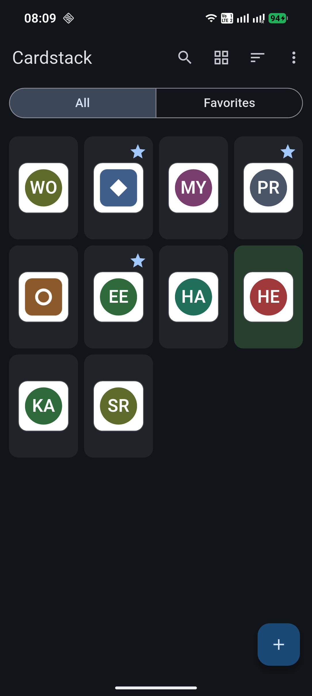
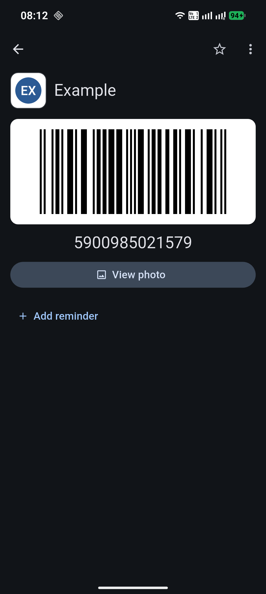
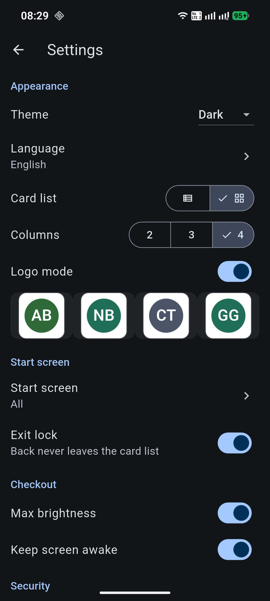

import HeadingWithIcon from '@reusables/HeadingWithIcon.astro';
import ImageGrid from '@reusables/ImageGrid.astro'
import ImagePreview from '@reusables/ImagePreview.astro'

<ImagePreview />

<HeadingWithIcon icon="game-icons:card-pick" title="Cardstack" />

**Cardstack** is an [Android application](https://www.android.com/) that keeps all your loyalty, membership and discount cards on your phone — no wallet bulging at the seams, no accounts, no cloud. It is fully offline by design: it does not even request internet access, so your cards technically cannot leave your device. At the checkout, your code is one tap away: big, bright and scannable.

<ImageGrid>
  
  
  
</ImageGrid>

## Key Features

### Made for the Checkout
- **One-tap codes:** open a card and the barcode is right there, rendered
  large with boosted brightness so scanners read it first try.
- **Fast built-in scanner:** point, capture, done — with pinch zoom and a
  hold-to-aim mode for small or glossy codes.
- **Expiry reminders:** get notified before your cards or coupons expire,
  even after a phone reboot.
- **Favorites widget & shortcuts:** pin daily cards to the home screen or
  jump straight to them from launcher shortcuts.

### Privacy & Security
- **100% offline:** no accounts, no analytics, no ads, no tracking — and no
  `INTERNET` permission in the first place.
- **On-device everything:** cards, photos, settings, widget and shortcuts
  live only in the app's private storage.
- **Encrypted backups:** password-protected `.cardstack` exports are
  encrypted on your device; the password never leaves it.
- **Optional app lock:** protect the whole wallet with Android biometric
  authentication, plus screenshot blocking and hiding in recent apps.

### Yours to Arrange
- **Grid or list**, ten themes (including terminal-inspired GitHub,
  Catppuccin, Dracula, Gruvbox and Solarized palettes), four languages.
- **Personal touch:** photos of each card, custom colors, tags, manual
  ordering, recently/most-used sorting.
- **Forgiving by default:** trash with 30-day recovery, duplicate warnings,
  export and import for safekeeping.

## Compatibility & OS Support

Cardstack runs on **Android 12 and newer** (phones and tablets) and works
fully offline — including the barcode scanner, which ships its recognition
engine inside the app. The interface is available in **English, Polish,
German and Dutch**.

## What is it for?

Cardstack is for anyone whose wallet overflows with plastic: grocery,
fuel, pharmacy, gym, library and coffee-shop cards — all searchable and
scannable from one place. It is also a good fit if you simply do not want
yet another account and yet another cloud holding copies of your personal
stuff: here, your cards are yours, on your phone, period.

## Get it & Contact

- Google Play: [Cardstack (one.dav.cardstack)](https://play.google.com/store/apps/details?id=one.dav.cardstack)
- Privacy policy: [dav.one/privacy-policy/cardstack](/privacy-policy/cardstack/)
- Contact: cardstack@dav.one
